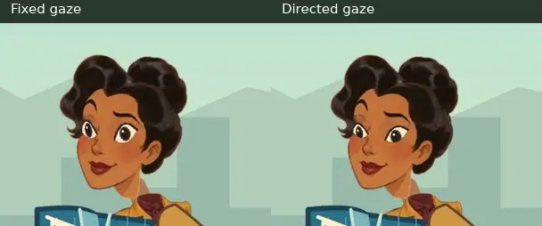

# Marvel Engineer acting test

This 12-second silent scene tests whether two original cutout characters can carry a joke through motion. The crooked floor at the left of the site appears on Milo’s folded drawing. The owner takes the sheet, opens the cross-fold, sees the straight drawing and points at Milo. Milo answers with his chest out and a grin.

## Reproduce on Linux

Use Package A’s Python 3.11 environment. Install FFmpeg and FFprobe with libx264 on PATH. The Godot comparison also needs the external Godot 4.6.3 executable named `godot`. The renderer itself runs locally with a dummy display. The spike dependencies stay in the development environment.

```sh
python3.11 -m venv .venv
.venv/bin/pip install -e '.[dev]' -c constraints/dev-linux-cpython311.txt
.venv/bin/pip install -r spikes/studio_s1/requirements.txt
.venv/bin/python -m pytest -q spikes/studio_s1/test_performance.py
.venv/bin/python spikes/studio_s1/render.py --backend godot --workspace work/s1
.venv/bin/python spikes/studio_s1/render.py --backend native --workspace work/s1
```

Each command prints a new attempt directory. Open its `marvel-engineer.mp4`. For a 640×360 rehearsal add `--width 640`. Both modes rasterize vectors at the selected resolution. `settings.json` identifies the source files, toolchain and output settings. `manifest.json` records the decoded result, timing and ordered input-to-encoder RGB hashes for frames 0 through 287. Errors retain a diagnostic in the attempt directory. Retrying the command creates a fresh directory. The existing `animalite` CLI and the benchmark have separate inputs and evidence.

## Direct the scene

| Frames (inclusive) | Performance to inspect |
| --- | --- |
| 0–31 | Owner’s pupils lead the head up to the tilted floor. Milo shifts his weight before stepping. |
| 32–80 | Milo swings the far boot and plants it, then swings the near boot. Watch the supporting sole against the ground as each knee flexes. |
| 81–129 | Milo turns and offers the folded plan with both hands. The camera starts closing in as the owner reaches. |
| 130–168 | Both touch the near corner first. Ownership changes at 143. The owner takes the weight before Milo withdraws the second hand. |
| 169–210 | Two grips separate as the crease opens. Compare the two floors on the drawing before and after the snap. |
| 211–287 | Owner recoils and points. Milo waits through the rebuke, straightens and touches his chest. |

Edit `milo.svg` or `owner.svg` to change the head, torso or shoe. Each named group uses a local pivot. The two-link chains and attachments live in `rigs.json`. The timeline in `performance.py` sets world-space foot locks, wrist targets, gaze, facial acting and camera curves at integer frame indices. Both backends receive the same targets and art. The blueprint stays in a single coordinate system through the transfer. `artwork.py` draws its two floors and crease from a continuous unfold parameter. The set in `site.svg` can be reused independently.

The Godot experiment drives actual Bone2D chains and the engine’s two-bone IK modifier, then rasterizes the posed vector layers using its CPU image API. The Python comparison solves each chain analytically and streams resvg output. Neither path requires a display, weights, generated stock footage or a video service.

The draft PR includes a [decoded frame sheet](../../docs/verification/studio-s1/contact-sheet.webp), the [four run records](../../docs/verification/studio-s1/runs.json) and the [backend decision](../../docs/decisions/STUDIO-S1-rig-feasibility.md). The shared workspace review player offers the MP4s and raw evidence ZIP. Repository hosting of the videos is pending.

## Review the inspector’s gaze and blueprint grip



The right-hand take shows the inspector looking down at the drawing, holding through the reveal and looking across at Milo before the pointing gesture. The left-hand control holds her pupils centered and lids open. Both take the same body, facial expression, prop and camera tracks. The comparison uses source frames 165 through 236, with a common crop around the inspector.

Run these from the repository root. Each command renders just the specified source frames. Use either backend and choose 640 or 1280 pixels wide. Omitting both frame arguments renders the full 288 frames. Frame zero is the beginning of the original shot. The stop is exclusive, and the output contract requires at least two frames.

```sh
.venv/bin/python spikes/studio_s1/render.py --backend native --character inspector --start-frame 165 --stop-frame 237 --workspace work/s1
.venv/bin/python spikes/studio_s1/render.py --backend native --character inspector --gaze fixed --start-frame 165 --stop-frame 237 --workspace work/s1
.venv/bin/python spikes/studio_s1/render.py --backend godot --character inspector --width 640 --start-frame 125 --stop-frame 154 --workspace work/s1
.venv/bin/python -m pytest -q spikes/studio_s1
```

The inspector’s three small WebP assets are derived from the original ImageGen model sheet created for this S1 shot. The expression strip contains nine registered drawings in one view, with the painted eyes cleared. The head keeps its expression and angle as the fitted pupils and upper and lower lids move. Edit the eye fits in `inspector_art.py` and the gaze and blink timing in `performance.py`. The coat and boots attach separately to the rig.

Each render projects every supported hand onto the folding blueprint in final image coordinates. Within a ten-stage-pixel radius, it counts the hand’s distinct fill pixels that sit within three stage pixels of visible blueprint fill or outline, scaled for camera zoom and resolution. A missing contact stops the encode and records the source frame and hand in `failure.json`. Successful counts are in `manifest.json` under `visible_grip_pixels_by_frame`, ordered from the recorded start frame. This checks the compositor output immediately before H.264 encoding. A reviewer still judges whether the grasp and the eye movement read at playback speed.

The upstream B5 gaze and B6 handoff workflows informed this implementation. The spike uses AnimaLite’s own code, character artwork and folding-sheet geometry. [Upstream revision](https://github.com/kaomei/stickman-video-director/tree/f59453689af24255aa5989151fc9ab83f4d6357c/skills/directing-stickman-videos)

For a mid-shot preview, Godot replays the preceding IK targets to establish its bone transforms before rasterizing the selected frames. Both backends retain their authored 24 fps cadence. The [measured runs](../../docs/verification/studio-s1/inspector-gaze-runs.json) include the frame-hash comparison against the full shot, visible grip counts, pixel isolation check, timing and memory measurements.

## Review the encoded take

Every S1 render now saves `review.webp` and `review.json` beside the MP4. Open the sheet to see the foot plant, shared grip, blueprint reveal and pointing gesture in the delivered picture. Range previews use the same source frame numbers as the full shot. The sheet includes both range endpoints, relevant acting beats and up to four flagged frames. The JSON lists all findings with an inclusive start and exclusive stop. The manifest binds the sheet, report and MP4 by SHA-256. [Example sheet from the 12-second inspector take](../../docs/verification/studio-s1/inspector-take-review.webp)

The review decodes every frame at 64 × 36 luma and samples selected color frames from the encoded clip. It marks six or more nearly black frames, at least 24 nearly stationary frames and isolated large picture changes. These are playback cues for this lit, single-shot scene. Small pupil movements can disappear at this resolution, and an intentional comic hold can trigger a stillness finding. Clip length and decode failures remain errors. The dedicated grip and eye tests cover their own signals.

### FreeVideo verification

At upstream commit `225997487d52a873882183245c594e3b0249a3d6`, we executed FreeVideo’s finished-take checker on the actual 72-frame inspector clip using PyAV 18.1.0. Its contact-sheet helper returned decoded frames 0, 14, 28, 43, 57 and 71. The checker reported no picture problems and flagged the missing audio track on our intentionally silent clip. On a controlled copy with a white first frame, 12 black frames and a 40-frame repeated tail, it reported an opening flicker, black picture at 0.42–0.88 s and a freeze at 1.29–2.96 s. AnimaLite independently implements visual review with its existing supervised FFmpeg path and acting timeline. [Upstream take checker](https://github.com/FlashML-org/FreeVideo/blob/225997487d52a873882183245c594e3b0249a3d6/freevideo_engine/agent/take_qa.py) · [Upstream contact sheet](https://github.com/FlashML-org/FreeVideo/blob/225997487d52a873882183245c594e3b0249a3d6/freevideo_engine/agent/media.py#L158)

FreeVideo routes H3 inference to CUDA or Apple MPS. A direct call to its backend selector with `cpu` raised `ValueError`. We did not run H3 generation or verify its advertised minimum VRAM. FreeVideo licenses its code under Apache-2.0 and identifies the separate MiniMax H3 Community License for weights. The S1 implementation uses neither FreeVideo code nor model weights. [Backend selector](https://github.com/FlashML-org/FreeVideo/blob/225997487d52a873882183245c594e3b0249a3d6/freevideo_engine/backends/__init__.py) · [Upstream notice](https://github.com/FlashML-org/FreeVideo/blob/225997487d52a873882183245c594e3b0249a3d6/NOTICE)

| Local S1 run | Decoded frames | Added review time | Picture findings |
| --- | ---: | ---: | --- |
| Godot, 1280 × 720, full shot | 288 | 1.07 s | Near-still source frames 263–287 during the closing pose |
| Native, 1280 × 720, frames 165–236 | 72 | 0.56 s | None |
| Same native take, controlled defects | 72 | — | Opening jump at 165, black from 175 through 186, near-still from 196 through 236 |

The two clean MP4s matched the corresponding earlier S1 deliveries byte for byte. The final 25 full-shot source frames had distinct RGB hashes. Review time covers the two FFmpeg decode passes, analysis, sheet and report writing, and hashing the encoded take on the Codex Cloud development host.
